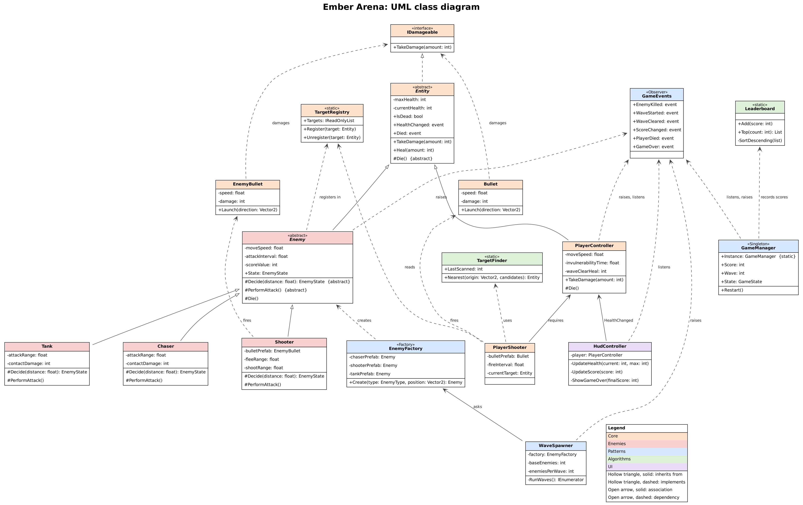

# Ember Arena

Ember Arena is a 2D top-down wave-survival game built in Unity. You move around an arena while your gun fires automatically at the nearest enemy, and each wave brings more and tougher enemies. I built it to practise object-oriented design, design patterns, UML and algorithms in a real Unity project.



## Requirements

- Unity Hub
- Unity 6000.4.7f1 (the version this project was made with, so Unity won't ask to upgrade it)
- Git

## Setup

1. Clone the repository:

   ```
   git clone https://github.com/dduru26/ember-arena.git
   ```

2. Open Unity Hub, click **Add** and then **Add project from disk**, and select the `ember-arena` folder.
3. Open the project with Unity 6000.4.7f1. The first import takes a few minutes while Unity restores packages.
4. If the Hierarchy is empty, open `Assets/Scenes/SampleScene.unity`.
5. Press **Play**.

No extra packages or asset downloads are needed. Active Input Handling is already set to **Both** in the project settings.

## How to play

| Action | Control |
|---|---|
| Start | Any key on the title screen |
| Move | W A S D or the arrow keys |
| Shoot | Automatic, at the nearest enemy |
| Restart | R after game over |

Enemies arrive in waves from the edges of the arena. Clearing a wave restores a little health.

| Enemy | First appears | Behaviour |
|---|---|---|
| Chaser | Wave 1 | Runs at you and hits on contact. Flees when its health is low. |
| Shooter | Wave 2 | Keeps its distance and fires bullets at you. Backs away if you get close. |
| Tank | Wave 3 | Slow and tough, hits hard on contact, never flees. |

## Where to find each concept

| Concept | Where |
|---|---|
| Encapsulation | `Entity.cs`, where health is private and changes only through `TakeDamage` and `Heal` |
| Abstraction | `IDamageable.cs`, plus the abstract classes `Entity.cs` and `Enemy.cs` |
| Inheritance | `Entity` to `PlayerController` and `Enemy`, then `Enemy` to `Chaser`, `Shooter` and `Tank` |
| Polymorphism | `Decide` and `PerformAttack` overrides in the enemy classes, and `PlayerController.TakeDamage` |
| Singleton | `Patterns/GameManager.cs` |
| Factory | `Patterns/EnemyFactory.cs`, used by `Patterns/WaveSpawner.cs` |
| Observer | `Patterns/GameEvents.cs`, the `HealthChanged` event in `Entity.cs`, and `UI/HudController.cs` |
| Algorithm 1: nearest-target search | `Algorithms/TargetFinder.cs`, called from `Core/PlayerShooter.cs` |
| Algorithm 2: enemy state machine | `Enemies/Enemy.cs`, with the rules in `Chaser.cs`, `Shooter.cs` and `Tank.cs` |
| Bonus: leaderboard insertion sort | `Algorithms/Leaderboard.cs` |

## Project structure

```
Assets/
  Scenes/SampleScene.unity
  Prefabs/                 Player, Chaser, Shooter, Tank, Bullet, EnemyBullet
  Scripts/
    Core/                  Entity, IDamageable, PlayerController, PlayerShooter, Bullet, EnemyBullet, TargetRegistry
    Enemies/               Enemy, Chaser, Shooter, Tank, EnemyState, EnemyType
    Patterns/              GameManager, EnemyFactory, GameEvents, WaveSpawner, GameState
    Algorithms/            TargetFinder, Leaderboard
    UI/                    HudController
docs/
  uml-class-diagram.png
```

## Assets

The game uses no third-party art, audio or fonts. See [ASSETS.md](ASSETS.md) for exactly what each visual is and where it came from.
